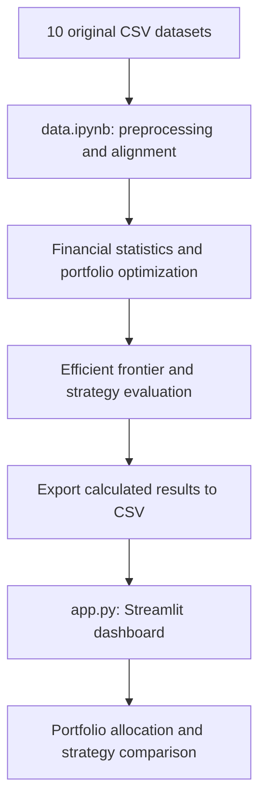

# Mean-Variance Portfolio Optimization

**A Risk-Return Analysis for Personal Investment Decisions**


## Overview

This university Finance course project implements Harry Markowitz's mean-variance portfolio theory using historical Indian equity data. Its objective is to demonstrate how a hypothetical investment can be distributed among nine stocks by considering expected return, volatility and the relationships between asset returns.

The project consists of a Jupyter Notebook containing the complete data preparation, mathematical analysis and numerical optimization, and a Streamlit dashboard that presents the calculated results through an interactive interface. The NIFTY 50 index is used as a market benchmark, not as an investable asset in the optimization model.

The dashboard is an educational tool for exploring historical risk-return trade-offs. It does not predict stock prices, execute trades or provide current investment recommendations.

## Objectives

- Prepare and align historical price data for nine stocks and the NIFTY 50 index.
- Estimate asset returns, variance, volatility, covariance and correlation.
- Construct equal-weight, minimum-variance, maximum-Sharpe-ratio and target-return portfolios.
- Visualize the efficient frontier and compare portfolio allocations.
- Evaluate strategies over a separate historical holdout period.
- Present the notebook's results through a reproducible, interactive web application.

## Features

| Feature | Description |
| --- | --- |
| Investment allocation | Enter hypothetical capital in INR and calculate the amount assigned to each stock. |
| Equal-weight portfolio | Allocate the same proportion to each of the nine stocks. |
| Minimum-variance portfolio | Minimize estimated portfolio variance. |
| Maximum-Sharpe portfolio | Maximize estimated excess return per unit of volatility. |
| Target-return portfolio | Select from 50 precomputed efficient-frontier portfolios. |
| Apply button | Update the dashboard only after submitting sidebar settings. |
| Interactive visualization | View a portfolio allocation chart and efficient-frontier chart using Plotly. |
| Strategy comparison | Compare full-period results and separate out-of-sample performance against NIFTY 50. |
| CSV export | Download the selected portfolio's allocation table. |
| Statistical analysis | Inspect covariance and correlation heatmaps and financial calculations in the notebook. |

## Dataset

The analysis uses ten historical CSV files: nine individual stocks and one market index. The files contain daily observations with date, open, high, low, close and volume fields. Closing prices are used to calculate returns.

| Company / Index | Sector or role | Original CSV file |
| --- | --- | --- |
| Infosys | Information technology | `INFOSYS.csv` |
| HDFC Bank | Banking | `NSE_HDFCBANK_from2000.csv` |
| Hindustan Unilever | FMCG | `NSE_HINDUNILVR_from2000.csv` |
| Reliance Industries | Diversified | `NSE_RELIANCE_from2000.csv` |
| Tata Consultancy Services | Information technology | `NSE_TCS_from2000.csv` |
| Bharti Airtel | Telecommunications | `Bharti_AIRTEL.csv` |
| ICICI Bank | Banking | `ICICI.csv` |
| Larsen & Toubro | Engineering and infrastructure | `L&T.csv` |
| Sun Pharma | Pharmaceuticals | `Sun_Pharma.csv` |
| NIFTY 50 | Market benchmark | `NIFTY_50(INDEX)from2000.csv` |

The original four stock datasets and the index are available in the [Stock Market Datasets NSE repository](https://github.com/Gajapathy-Selvaraj/Stock_Market_Datasets_NSE). The five additional CSVs were supplied to the project team; their original provider has not been independently verified.

### Study period

| Parameter | Value |
| --- | --- |
| Common study window | 25 January 2016 – 25 January 2021 |
| Training cutoff | 25 January 2019 (inclusive) |
| Holdout period | After 25 January 2019 through 25 January 2021 |
| Aligned price observations | 1,232 |
| Valid daily return observations | 1,226 |
| Trading periods per year (annualization) | 252 |
| Assumed annual risk-free rate | 5% |

The five-year window is used for the main interactive portfolio analysis. For the separate out-of-sample evaluation, portfolio weights are estimated using only the first three years and evaluated using the subsequent two years.

### Data preprocessing

The notebook parses the different source date formats, normalizes timestamps, filters the data to the common study window, aligns all ten series on common dates and verifies the processed prices. The observed trading-date sequence is restored before percentage returns are calculated, so missing observed sessions are not silently treated as ordinary one-day returns. Incomplete return rows are excluded from the analysis.

## Mathematical methodology

### 1. Daily returns and annualization

For closing price $P_{i,t}$ of stock $i$ at time $t$, the simple daily return is

$$
r_{i,t}=\frac{P_{i,t}}{P_{i,t-1}}-1.
$$

The annualized arithmetic mean return vector and covariance matrix are estimated using the daily sample mean and covariance:

$$
\boldsymbol{\mu}=252\,\overline{\mathbf r},\qquad
\Sigma=252\,\operatorname{Cov}(\mathbf r).
$$

### 2. Portfolio return and risk

Let $\mathbf w$ be the vector of portfolio weights. The estimated annualized return and volatility are

$$
E[R_p]=\mathbf w^\top\boldsymbol{\mu},\qquad
\sigma_p=\sqrt{\mathbf w^\top\Sigma\mathbf w}.
$$

The model is fully invested and long-only:

$$
\sum_{i=1}^{9}w_i=1,\qquad 0\leq w_i\leq 1.
$$

### 3. Portfolio strategies

**Equal weight.** Each of the nine stocks receives $w_i=1/9$ (approximately 11.11%).

**Minimum variance.** Minimize portfolio variance subject to the investment constraints:

$$
\min_{\mathbf w}\;\mathbf w^\top\Sigma\mathbf w.
$$

**Maximum Sharpe ratio.** Maximize estimated excess return per unit of volatility, using the assumed annual risk-free rate $R_f=0.05$:

$$
\max_{\mathbf w}\;\frac{\mathbf w^\top\boldsymbol{\mu}-R_f}{\sqrt{\mathbf w^\top\Sigma\mathbf w}}.
$$

**Target expected return.** Minimize portfolio variance with the additional constraint

$$
\mathbf w^\top\boldsymbol{\mu}=R_{\mathrm{target}}.
$$

The notebook uses SciPy's SLSQP constrained numerical optimizer. It constructs the efficient branch of the frontier over 50 equally spaced target returns from the global minimum-variance portfolio's return to the highest individual estimated return. In the supplied results, this range is approximately **21.41%–32.90%**. It is not a guaranteed investment return range.

### 4. Investment allocation

For hypothetical capital $A$, the amount assigned to asset $i$ is $A_i=A w_i$. Changing capital scales the amounts without changing the selected portfolio's weights, expected return or volatility. Zero weights are valid under the long-only constraints; the optimizer does not have to invest in every available stock.

## Project architecture



The notebook is the computational source of truth. The dashboard reads its exported results rather than independently fitting another portfolio model. This keeps the financial calculations and displayed results consistent.

### Directory structure

```text
Finance_Project/
├── data.ipynb
├── app.py
├── README.md
├── pyproject.toml
├── uv.lock                         # Generated by uv sync if absent
├── .python-version
├── .gitignore
├── data/
│   ├── ...                         # Ten original CSV datasets
│   └── streamlit_results/
│       ├── frontier.csv
│       ├── portfolio_weights.csv
│       ├── in_sample.csv
│       ├── training_weights.csv
│       ├── out_of_sample.csv
│       └── settings.csv
└── Dataset/
    └── 5 year/                     # Ten aligned, filtered CSV files
```

If a `requirements.txt` file is supplied, it may be retained as an alternative dependency list. `pyproject.toml` and `uv.lock` are the primary environment configuration for the uv workflow.

## Installation and usage

### Prerequisites

- Python 3.12 (the project declares support for Python 3.12 and 3.13)
- [uv](https://docs.astral.sh/uv/getting-started/installation/)
- VS Code with Python and Jupyter extensions, or another compatible notebook environment

On macOS, uv can be installed using Homebrew if it is not already available:

```bash
brew install uv
```

### 1. Obtain the project and install dependencies

Clone or download the project repository, open its root directory in a terminal, and run:

```bash
uv sync
```

This creates or updates the project's `.venv` and installs the dependencies. Manual environment activation is not required for `uv run` commands.

### 2. Run the notebook

1. Open `data.ipynb` in VS Code.
2. Select the Python interpreter inside the project's `.venv` as the notebook kernel.
3. Ensure the ten raw CSV files are in `data/`.
4. Run all analysis cells in order from the project root.
5. Confirm that `Dataset/5 year/` and `data/streamlit_results/` have been generated.

The original notebook's `%pip install openpyxl` and `%pip install ipywidgets` cells are retained. Those packages and `pip` are already declared as dependencies, so the installation cells may be skipped after a successful `uv sync`.

To confirm the notebook is using the correct environment:

```python
import sys
print(sys.executable)
```

The path should point to the project's `.venv` Python interpreter.

### 3. Launch the dashboard

From the project root:

```bash
uv run streamlit run app.py
```

Open [http://localhost:8501](http://localhost:8501) in a browser. If the six result CSV files are already present, the dashboard can be launched without first rerunning the notebook. Rerun the notebook to regenerate results after changing source data or model settings.

### 4. Use the application

1. Enter a hypothetical investment amount in INR.
2. Select an optimization objective in the sidebar.
3. For **Target expected return**, choose one of the available target-return values.
4. Click **Apply** to update the portfolio allocation, metrics and charts.
5. Inspect the **Strategy comparison** tab for full-window and holdout results.
6. Use **Download allocation CSV** to save the selected allocation.

The investment universe, estimation dates and assumed risk-free rate are fixed by the notebook. The interface does not optimize arbitrary stock subsets or arbitrary return values; its target slider selects one of the 50 saved solutions.

<!-- Optional: add a dashboard screenshot after uploading it to the repository.

-->

## Results

### Five-year in-sample comparison

| Strategy | Annualized mean return | Annualized volatility | Sharpe ratio |
| --- | ---: | ---: | ---: |
| Equal weight | 21.52% | 17.65% | 0.936 |
| Minimum variance | 21.41% | **16.32%** | 1.005 |
| Maximum Sharpe | **26.61%** | 17.59% | **1.228** |
| NIFTY 50 | 15.34% | 18.15% | 0.569 |

The minimum-variance strategy achieves the lowest estimated volatility among the compared strategies, whereas the maximum-Sharpe strategy achieves the highest estimated Sharpe ratio. These are full-window estimates, not out-of-sample results.

### Separate out-of-sample comparison

Portfolio weights are estimated through 25 January 2019 and applied to the remaining observations through 25 January 2021.

| Strategy | Annualized mean return | Annualized volatility | Sharpe ratio |
| --- | ---: | ---: | ---: |
| Equal weight | **28.61%** | **23.11%** | **1.022** |
| Minimum variance | 27.31% | 23.27% | 0.959 |
| Maximum Sharpe | 25.26% | 24.63% | 0.822 |
| NIFTY 50 | 18.53% | 24.47% | 0.553 |

In this particular holdout window, equal weighting achieves a higher realized annualized mean return and Sharpe ratio, and lower realized volatility, than either optimized strategy. This illustrates that portfolios optimized on historical estimates need not remain optimal when market conditions change.

All figures above are rounded from the notebook's exported `in_sample.csv` and `out_of_sample.csv`. They are annualized arithmetic mean returns, not cumulative returns. The holdout table evaluates the three strategies using separately estimated training weights; it does not evaluate the full-window target-return portfolio selected in the dashboard.

## Validation and testing

The notebook verifies the alignment and validity of its price table, the number of investment assets, optimizer convergence, equal-weight allocations and fully invested portfolio weights. The export cell additionally checks the frontier array dimensions and the sum of frontier weights.

Suggested dashboard checks:

| Test | Expected result |
| --- | --- |
| Equal weight, INR 100,000 | Nine allocations of approximately 11.11% each (INR 11,111.11 before rounding residuals). |
| Change investment capital | Currency allocations scale; weights and percentage metrics remain unchanged. |
| Edit sidebar settings without applying | Dashboard retains its previous applied settings. |
| Click Apply | Selected settings are reflected in the dashboard. |
| Minimum variance | Full-window estimated volatility is approximately 16.32%. |
| Maximum Sharpe | Full-window estimated Sharpe ratio is approximately 1.228. |
| Target-return selection | Displayed return matches the selected precomputed solution after applying, within display precision. |
| Strategy comparison | Separate in-sample and out-of-sample tables are displayed. |
| CSV download | Selected stock names, weights and INR allocations are exported. |

These checks establish consistency with the implemented model; they do not establish future investment performance.

## Assumptions and limitations

- The common dataset ends in January 2021; this is historical analysis, not a live market tool.
- Corporate-action and dividend adjustments have not been independently verified. Results should not be treated as verified total returns.
- The sample is restricted to nine selected stocks and a single benchmark, so results are conditional on the investment universe.
- Historical means, variances and correlations may change over time. Volatility does not capture every form of financial risk.
- The 5% annual risk-free rate is a modeling assumption rather than a verified historical rate series.
- Returns surrounding missing observed sessions are excluded. Annualization assumes 252 daily periods per year.
- The model assumes fully invested long-only portfolios, fixed target weights (effectively constant-weight returns on retained observations), fractional allocations, and no taxes or transaction costs.
- A single chronological holdout is insufficient to establish generalizable strategy superiority.
- The dashboard uses saved portfolio solutions and does not dynamically refit the model.

## Technology stack

| Tool | Purpose |
| --- | --- |
| Python | Programming language |
| NumPy | Numerical and matrix calculations |
| pandas | Data preparation and financial statistics |
| SciPy | SLSQP constrained optimization |
| Matplotlib and Seaborn | Notebook graphs and statistical heatmaps |
| Plotly | Interactive dashboard charts |
| Streamlit | Web application |
| Jupyter and ipykernel | Reproducible notebook execution |
| uv | Environment and dependency management |

The environment also retains `openpyxl`, `ipywidgets` and `pip` for compatibility with the original notebook cells.

## Implementation and reproducibility

The original notebook's data preprocessing, financial formulas, optimization algorithms and analysis are preserved. Integration changes are limited to portable input/output paths and replacement of the final interactive widget cells with result exports and dashboard launch instructions. `app.py` provides the separate Streamlit interface.

For reproducible results, keep the original CSV datasets, notebook, dashboard source, `pyproject.toml` and `uv.lock` together. Do not commit the local `.venv/`, `__pycache__/`, `.ipynb_checkpoints/` or `.DS_Store` directories/files.

## Future scope

- Use verified adjusted price data and extend the common analysis window.
- Support user-defined stock selections and risk-free rates with on-demand optimization.
- Incorporate transaction costs, realistic share quantities and periodic rebalancing.
- Evaluate strategies across multiple rolling out-of-sample periods.

## Team

| Name | Student ID |
| --- | --- |
| Subham Dangar | B2530090 |
| Ankan Bera | B2530070 |
<!-- Add the third team member here using the same Markdown table row format. -->

**Course:** Finance  
**Department:** Computer Science  
**Institution:** Ramakrishna Mission Vivekananda Educational and Research Institute (RKMVERI)

## References

1. Markowitz, H. (1952). Portfolio Selection. *The Journal of Finance*, 7(1), 77–91. [DOI: 10.1111/j.1540-6261.1952.tb01525.x](https://doi.org/10.1111/j.1540-6261.1952.tb01525.x).
2. [Stock Market Datasets NSE — historical dataset repository](https://github.com/Gajapathy-Selvaraj/Stock_Market_Datasets_NSE).
3. [SciPy — `scipy.optimize.minimize` documentation](https://docs.scipy.org/doc/scipy/reference/generated/scipy.optimize.minimize.html).
4. [Streamlit documentation](https://docs.streamlit.io/).
5. [Plotly Python documentation](https://plotly.com/python/).
6. [uv documentation](https://docs.astral.sh/uv/).

---

*Developed as an academic demonstration of mean-variance portfolio theory. Historical estimates are not forecasts or personalized investment advice.*
